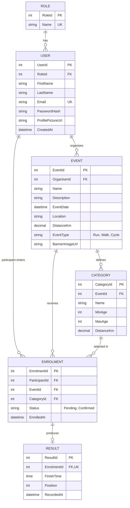

# RaceDay ERD

## Cardinality
- Role 1 : M User
- User (Organiser) 1 : M Event
- Event 1 : M Category
- Event M : M User (Participant), resolved by Enrolment
- Category 1 : M Enrolment
- Enrolment 1 : 0..1 Result

## Constraints
- User.Email unique; Role.Name unique
- Enrolment unique on (ParticipantId, EventId): one enrolment per event
- Result.EnrolmentId unique (1:1)
- Event to Category cascades on delete; all other FKs restrict, which avoids SQL Server multiple cascade paths
